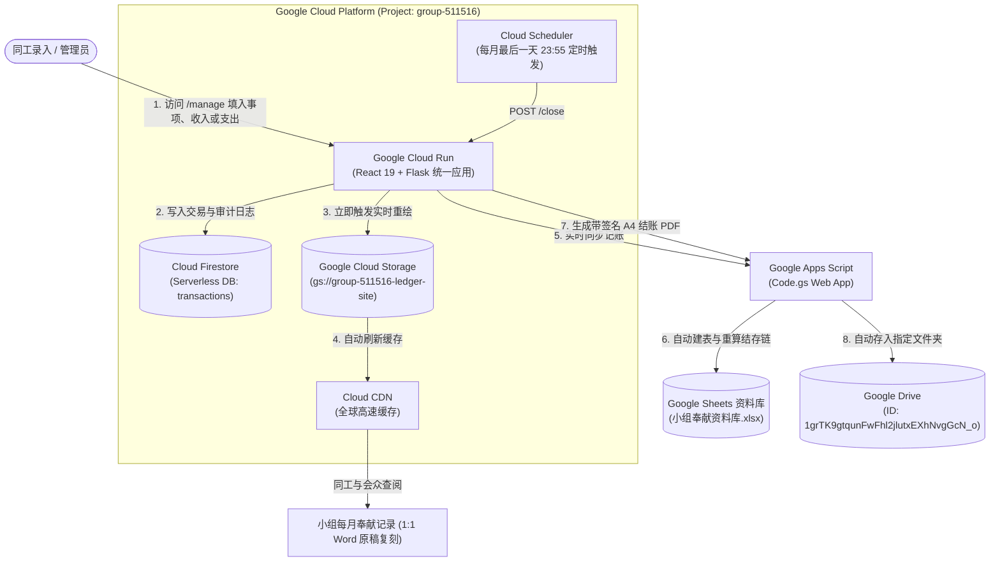

# Group Finance (小组奉献) – Serverless Ledger Pipeline

[](#)
[](#)
[](#)
[](#)

> **Executive Summary**: This project, **Group Finance (小组奉献)** on Google Cloud Platform (project `group-511516`, region `asia-southeast1`, timezone `Asia/Kuala_Lumpur`), replaces a legacy Netlify frontend with a unified, 100% Serverless GCP pipeline hosted on Cloud Run under `Group Finance/pipeline`: the service serves both the Manage React 19 application (`/manage`, credentials `admin` / `Abc1234#`) and the official Booklet UI (`/booklet`, an exact 1:1 replica of the Word document with top-to-bottom stacked month cards, 975px containers, 800px tables, `MM-DD` dates, and precise footer alignments); submitting a transaction via `POST /api` writes immediately to Cloud Firestore (`transactions` collection), synchronizes to Google Sheets via an upgraded Apps Script (`Code.gs`) that auto-provisions missing month sheets and recomputes the entire year's running balance chain, echoes the entry in Recent Activity and Yearly Overview, instantly re-publishes static pages to Google Cloud Storage (`gs://group-511516-ledger-site`) with Cloud CDN cache invalidation, and uses Cloud Scheduler on the last day of each month (`POST /close`) to generate a signed A4 PDF archived to GCS and uploaded directly into Google Drive folder `1grTK9gtqunFwFhl2jlutxEXhNvgGcN_o`; the system passes all 18 Pytest and 12 Apps Script automated tests, is actively running locally on port 8000, has been scaffolded with an Orchestrator-Legion Claude Code agent team (`CLAUDE.md`, `.orchestrator-legion.json`, and backend/frontend/devops ownership roles), and is ready for production deployment via `CONFIRM_DEPLOY=yes ./deploy/deploy_cloud_run.sh`.

---

## 1. System Architecture



---

## 2. Core Functional Components

### 2.1 Manage Group Finance Web App (`/manage` & `/`)
- **Technology Stack**: React 19, Tailwind CSS, Lucide icons (extracted from Netlify).
- **Authentication**: There is no default account. Users are Firestore documents `users/<username>` holding salted Werkzeug (scrypt) password hashes; legacy unsalted SHA-256 hashes still verify once and are upgraded on that login. Create or reset a user with `python "Group Finance/pipeline/scripts/create_user.py" --project <gcp-project-id> <username>` (needs Application Default Credentials with Firestore write access; the password is prompted twice, minimum 12 characters, and never printed). A successful `login` sets an HttpOnly, Secure, SameSite=Strict `ledger_session` cookie that is valid for 12 hours and signed with `PIPELINE_TOKEN`; if `PIPELINE_TOKEN` is unset, login returns 503. Every other `/api` action requires that session or the pipeline token (`X-Pipeline-Token`); the booklet's `booklet_auth` cookie may only call `delete_record`. Cross-origin requests (an `Origin` whose host differs from the request's host) are rejected with 403.
- **Transaction Submission**:
  - Validates input: strictly forbids negative numbers and prevents simultaneous income and expense values.
  - Automatically routes to the unified backend endpoint (`POST /api`).
- **Immediate Echo & Feedback**:
  - Success alert popup.
  - Form resets automatically.
  - **Recent Activity (最近记录)** immediately displays the newly posted entry plus the prior 4 transactions.
  - **Yearly Overview (年度总览)** instantly fetches updated month-by-month summaries from Jan through Dec.

### 2.2 Official Monthly Booklet (`/booklet` & `/YYYY-MM.html`)
- **Design Authenticity**: Pixel-perfect 1:1 reproduction of the Microsoft Word booklet (`小组奉献记录Booklet 2026.docx`).
- **Layout Specifications**:
  - Card width: `975px` centered container with drop shadow and border.
  - Table: `800px` fixed width with standard column ratios (Date, Item, Income, Expense, Balance, Sign, Sign).
  - Row Heights: `48px` header, `37px` body data rows.
  - Date format: Standardized to `MM-DD` (e.g. `08-13`, `10-14`).
  - Layout Flow: **Top-to-bottom continuous vertical stack** of all month cards (Jan down to current month).
  - Navigation: Sticky glassmorphism header bar with Chinese month jump buttons (`1月` ~ `10月`).
- **Exact Footer Layout**:
  - Row 1: `Verify by: ________Brendon__________` (left column, 384px width).
  - `Name     :  _______Rivaldo___________` (anchored at 48% / 384px left offset, NOT right-justified).
  - Row 2: `Date: _______31/8/2026_______` (left column only; right side remains completely blank).

### 2.3 Unified API (`POST /api`)
All frontend and background calls communicate through a single secure endpoint:
| Action | Description | Payload Sample |
| :--- | :--- | :--- |
| `login` | Authenticates administrator | `{"action": "login", "username": "admin", "password": "..."}` |
| `get_yearly_summary` | Returns 12-month balance breakdown | `{"action": "get_yearly_summary", "year": 2026}` |
| `add_record` (default) | Submits transaction, syncs to Sheets & Firestore, triggers re-publish | `{"date": "2026-10-14", "item": "小组聚会", "income": 100, "expense": 0}` |

### 2.4 Month-End Closing Pipeline (`POST /close`)
- **Trigger**: Cloud Scheduler cron (`55 23 28-31 * *` in timezone `Asia/Kuala_Lumpur`).
- **Logic**: Inspects current calendar date; only executes on the actual last day of the month (unless `force=1` is passed).
- **Execution**:
  1. Computes final closing balance.
  2. Injects signatures (`Verify by: Brendon`, `Name: Rivaldo`, `Date: <last-day-date>`).
  3. Renders A4 landscape PDF (`小组奉献记录_YYYY-MM.pdf`).
  4. Calls Apps Script `save_pdf` to upload directly into Google Drive folder `1grTK9gtqunFwFhl2jlutxEXhNvgGcN_o`.
  5. Stores private archive backup in `gs://group-511516-ledger-private/archive/`.
  6. Re-publishes public CDN site.

---

## 3. Data Reconciliation (2026 Ledger Verification)

The spreadsheet was reconciled against the physical signed booklet pages (`Group Finance/小组奉献资料库_corrected.xlsx`):

| Month | Opening (b/f) | Total Income | Total Expense | Closing Balance | Key Transactions / Reconciliation Notes |
| :---: | :---: | :---: | :---: | :---: | :--- |
| **Jan 2026** | **693.00** | 367.00 | 548.00 | **512.00** | 14/1 小组 167; 16/1 转回给教会 -400; 17/1 白金 -50; 22/1 小组 89; 28/1 小组 111; 28/1 生日蛋糕 -98 |
| **Feb 2026** | **512.00** | 40.00 | 100.00 | **452.00** | 11/2 小组 40; 25/2 生日蛋糕 -100 |
| **Mar 2026** | **452.00** | 196.00 | 50.00 | **598.00** | 11/3 小组 98; 18/3 小组 98 (corrected from 90 in sheet); 25/3 生日蛋糕 -50 |
| **Apr 2026** | **598.00** | 100.00 | 88.00 | **610.00** | 15/4 小组 100; 22/4 生日蛋糕 -88 |
| **May 2026** | **610.00** | 150.00 | 100.00 | **660.00** | 13/5 小组 150; 27/5 生日蛋糕 -100 |
| **Jun 2026** | **660.00** | 100.00 | 50.00 | **710.00** | 17/6 小组 100; 24/6 生日蛋糕 -50 |
| **Jul 2026** | **710.00** | 238.00 | 450.00 | **498.00** | 08/7 小组 108; 15/7 小组 130; 22/7 教会退款/聚餐 -450 |
| **Aug 2026** | **498.00** | 90.00 | 0.00 | **588.00** | 13/8 小组 90 (matches signed booklet `media_1791909869993_fe20a72b.png`) |
| **Sep 2026** | **588.00** | 120.00 | 389.00 | **319.00** | 02/9 小组 -50; 13/9 小组 120; 17/9 爱心奉献 -250; 30/9 庆生蛋糕 -89 |
| **Oct 2026** | **319.00** | *(Active)* | *(Active)* | *(Active)* | Active month sheet auto-created with previous closing balance carryover |

---

## 4. Directory & File Organization

```
/Users/brendonang/Code/Google Cloud Project/
├── CLAUDE.md                             # Agent team rules, ownership boundaries, and instructions
├── .orchestrator-legion.json             # Orchestrator-Legion scaffold configuration
├── .gitignore                            # Ignores worktrees/ and temporary artifacts
├── .claude/
│   └── agents/                           # Claude Code subagent definitions
│       ├── orchestrator.md               # Sub-Orchestrator
│       ├── hr-manager.md                 # HR Manager (agent roster manager)
│       ├── backend-engineer.md           # Backend Engineer (owns pipeline/ledger_pipeline/)
│       ├── frontend-engineer.md          # Frontend Engineer (owns pipeline/frontend/)
│       └── devops-engineer.md            # DevOps Engineer (owns pipeline/deploy/)
├── .github/
│   ├── ISSUE_TEMPLATE/taskboard.md       # Task specification & acceptance template
│   └── PULL_REQUEST_TEMPLATE.md          # PR verification checklist
├── Group Finance/
│   ├── 小组奉献资料库.xlsx                # Original spreadsheet (unmodified)
│   ├── 小组奉献资料库_corrected.xlsx      # Corrected spreadsheet with Reconciliation tab
│   ├── 小组奉献记录Booklet 2026.docx      # Word booklet template design reference
│   └── pipeline/
│       ├── Dockerfile                    # Multi-stage production container build
│       ├── requirements.txt              # Production Python dependencies
│       ├── requirements-dev.txt          # Dev/test dependencies (pytest, weasyprint)
│       ├── frontend/                     # Manage Group Finance UI assets
│       │   ├── index.html                # Manage web app HTML entrypoint
│       │   └── index-Chv3jFTT.js         # React 19 app bundle (same-origin /api bridge)
│       ├── apps_script/                  # Google Apps Script integration
│       │   ├── Code.gs                   # Full script: repairWorkbook, add_record, save_pdf, export_ledger
│       │   └── test_code_gs.js           # Node.js automated test mock (12/12 passing)
│       ├── ledger_pipeline/              # Core application package
│       │   ├── service.py                # Flask service (/manage, /booklet, /api, /sync, /close)
│       │   ├── pipeline.py               # Orchestrator: site publishing & month-end closing
│       │   ├── render.py                 # Pure-python HTML renderer reproducing Word design
│       │   ├── firestore_db.py           # Cloud Firestore serverless persistence
│       │   ├── ledger.py                 # Balance chaining, parsing, chronological sorting
│       │   ├── sources.py                # Source abstraction (AppsScriptSource, XlsxSource)
│       │   ├── config.py                 # Settings dataclass & environment loading
│       │   ├── security.py               # Token verification & Netlify JWS validation
│       │   ├── pdfgen.py                 # WeasyPrint HTML to PDF generator
│       │   ├── cdn.py                    # Cloud CDN cache invalidation
│       │   └── storage.py                # Storage abstraction (GcsStorage, LocalStorage)
│       ├── deploy/                       # Automated deployment scripts
│       │   ├── deploy_cloud_run.sh       # Cloud Run, Firestore, GCS, IAM, Scheduler setup
│       │   └── setup_cdn.sh              # External Load Balancer & Cloud CDN setup
│       └── tests/
│           └── test_pipeline.py          # Pytest test suite (18/18 passing)
```

---

## 5. Local Development & Verification

### 5.1 Run Automated Tests
```bash
# Run backend pytest suite (18 tests)
"Group Finance/pipeline/.venv/bin/pytest" "Group Finance/pipeline/tests" -v

# Run Apps Script logic test (12 tests)
node "Group Finance/pipeline/apps_script/test_code_gs.js"
```

### 5.2 Start Local Server
```bash
# Starts service on port 8000 (without PIPELINE_TOKEN, /api login returns 503)
PIPELINE_TOKEN=local-dev-token PYTHONPATH="Group Finance/pipeline" PORT=8000 "Group Finance/pipeline/.venv/bin/python" -m ledger_pipeline.service
```
- **Manage Web App**: [http://localhost:8000/manage](http://localhost:8000/manage) (or [http://localhost:8000/](http://localhost:8000/))
- **Booklet Top-to-Bottom View**: [http://localhost:8000/booklet](http://localhost:8000/booklet)
- **Health Check**: [http://localhost:8000/healthz](http://localhost:8000/healthz)

### 5.3 Test API Endpoints Locally
```bash
# Local runs usually have no Firestore credentials, so there are no users and login returns 401.
# Use the pipeline token instead (start the app with PIPELINE_TOKEN=local-dev-token):
curl -s -X POST http://localhost:8000/api \
  -H "Content-Type: application/json" -H "X-Pipeline-Token: local-dev-token" \
  -d '{"action":"get_yearly_summary","year":2026}'

# With a user created by scripts/create_user.py in the Firestore project the app uses,
# log in once and reuse the session cookie (curl keeps Secure cookies for http://localhost):
curl -s -c cookies.txt -X POST http://localhost:8000/api \
  -H "Content-Type: application/json" \
  -d '{"action":"login","username":"<username>","password":"<password>"}'

curl -s -b cookies.txt -X POST http://localhost:8000/api \
  -H "Content-Type: application/json" \
  -d '{"action":"get_yearly_summary","year":2026}'

# Add Record: "action" is required; the author is taken from the session
curl -s -b cookies.txt -X POST http://localhost:8000/api \
  -H "Content-Type: application/json" \
  -d '{"action":"add_record","date":"2026-10-14","item":"小组测试奉献","income":100,"expense":0}'

# Logout clears the cookie
curl -s -b cookies.txt -c cookies.txt -X POST http://localhost:8000/api \
  -H "Content-Type: application/json" -d '{"action":"logout"}'
```

---

## 6. GCP Production Deployment Guide

Deploy target: **GCP Project `group-511516`**, Region **`asia-southeast1`**.

### Step 1: Deploy Cloud Run, Firestore, and Storage
```bash
cd "Group Finance/pipeline"

# Review actions with dry run
./deploy/deploy_cloud_run.sh

# Execute live deployment
CONFIRM_DEPLOY=yes ./deploy/deploy_cloud_run.sh
```
> The script will:
> 1. Enable required APIs (`run`, `cloudbuild`, `artifactregistry`, `secretmanager`, `cloudscheduler`, `storage`, `compute`, `firestore`).
> 2. Create GCS public site bucket (`gs://group-511516-ledger-site`) and private archive bucket (`gs://group-511516-ledger-private`).
> 3. Create Cloud Firestore in Native mode.
> 4. Create service account `ledger-pipeline@group-511516.iam.gserviceaccount.com` and assign `roles/storage.objectAdmin` and `roles/datastore.user`.
> 5. Generate and store `PIPELINE_TOKEN` in Secret Manager.
> 6. Deploy container to Cloud Run.
> 7. Configure Cloud Scheduler job `ledger-month-end` (`55 23 28-31 * *` Asia/Kuala_Lumpur).
> 8. Print the Cloud Run URL and `PIPELINE_TOKEN`.

### Step 2: Configure Cloud CDN & Custom Domain (Optional)
```bash
# Review
./deploy/setup_cdn.sh

# Deploy with custom domain (or omit DOMAIN for HTTP IP testing)
DOMAIN=finance.yourdomain.org CONFIRM_DEPLOY=yes ./deploy/setup_cdn.sh
```

### Step 3: Google Sheets Apps Script Setup
1. Open the Google Spreadsheet in Google Sheets.
2. Navigate to **Extensions > Apps Script**.
3. Replace the entire contents of `Code.gs` with [`Group Finance/pipeline/apps_script/Code.gs`](file:///Users/brendonang/Code/Google%20Cloud%20Project/Group%20Finance/pipeline/apps_script/Code.gs).
4. Go to **Project Settings (gear icon) > Script Properties** and add:
   - `PIPELINE_URL`: Your deployed Cloud Run service URL (e.g. `https://ledger-pipeline-xxxx.a.run.app`).
   - `PIPELINE_TOKEN`: The secret token printed in Step 1.
   - `DRIVE_FOLDER_ID`: `1grTK9gtqunFwFhl2jlutxEXhNvgGcN_o`.
5. Run the `repairWorkbook` function once from the editor toolbar to fix old `B3` headers and rebuild broken running balance chains in place.
6. Click **Deploy > Manage Deployments**, create a new version, and ensure execute access is set to **Anyone**.

---

## 7. Claude Code Agent Team (Orchestrator-Legion)

The codebase is structured for multi-agent autonomous programming:

| Agent Role | Definition File | Exclusive Directory Ownership | Responsibility |
| :--- | :--- | :--- | :--- |
| **Orchestrator** | Main Claude Session | *None (does not write code)* | Planning, task decomposition, reviewing diffs, user communication |
| **Sub-Orchestrator** | `.claude/agents/orchestrator.md` | *None* | Large feature delegation and coordinator |
| **HR Manager** | `.claude/agents/hr-manager.md` | `.claude/agents/`, `CLAUDE.md#Team Roster` | Agent hiring, firing, and roster maintenance |
| **Backend Engineer** | `.claude/agents/backend-engineer.md` | `Group Finance/pipeline/ledger_pipeline/` | Server-side logic, Firestore, API endpoints, balance math, tests |
| **Frontend Engineer**| `.claude/agents/frontend-engineer.md`| `Group Finance/pipeline/frontend/` | React 19 UI, Tailwind styles, static assets, form interaction |
| **DevOps Engineer** | `.claude/agents/devops-engineer.md` | `Group Finance/pipeline/deploy/` | Dockerfile, Cloud Run deploy scripts, CDN configuration, IAM |

To refresh agent rules in the future without overwriting customized team roles:
```bash
npx create-orchestrator-legion@latest sync
```
